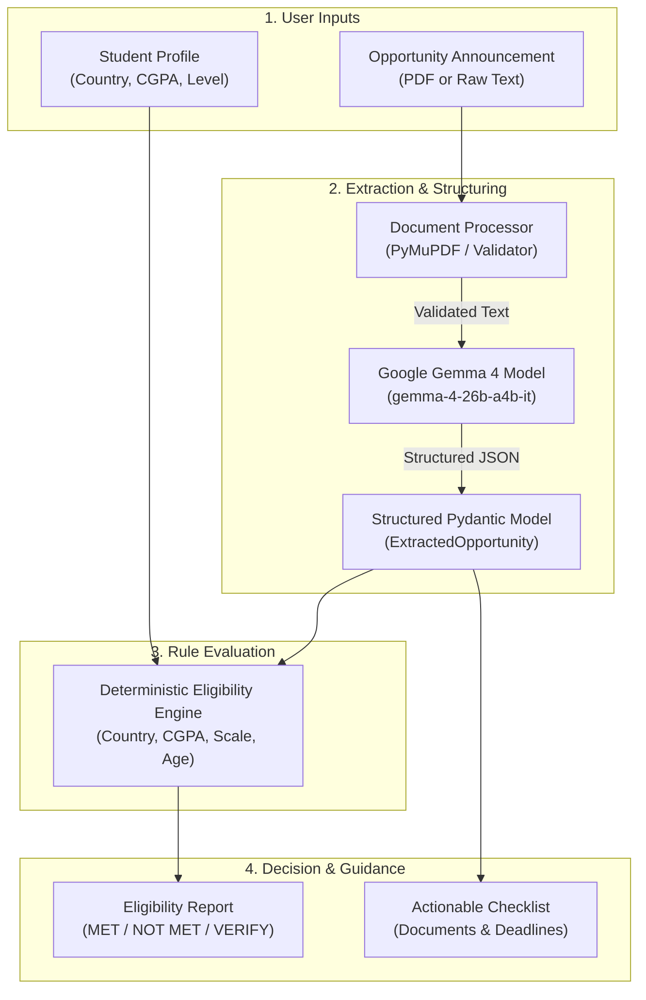

# 🔍 OpportunityLens

**Discover opportunities. Understand your eligibility. Take action.**

[](https://www.python.org/)
[](https://streamlit.io/)
[](https://ai.google.dev/gemma)
[](LICENSE)

OpportunityLens is an open-source, AI-powered opportunity analysis and application readiness platform. It helps students, researchers, and early-career professionals demystify scholarship, fellowship, internship, and grant announcements.

By combining the natural language understanding of **Google's Gemma 4** open model with a transparent, deterministic rule-based evaluation engine, OpportunityLens extracts complex eligibility criteria from dense documents, compares them against a student's profile, and delivers an explainable eligibility assessment alongside an interactive preparation checklist.

---

## 📌 Problem & Vision

Every year, thousands of students miss out on life-changing scholarships and educational opportunities:
- **Dense, ambiguous announcements:** Opportunity announcements are often buried in multi-page PDFs with convoluted guidelines and legal jargon.
- **Hidden disqualifiers:** Critical eligibility nuances—such as grading scale conversions, geographic restrictions, or academic standing—are easily overlooked.
- **Application friction:** Students waste time preparing materials for programs they do not qualify for, or conversely, self-select out of opportunities they qualify for because requirements seem intimidating.

**OpportunityLens addresses this gap:**
Instead of operating as an unpredictable black-box chatbot, OpportunityLens enforces structured data extraction and auditable rule evaluation. Students receive unambiguous status indicators, evidence citations traced directly back to source documents, and concrete steps to prepare a competitive application.

---

## ✨ Features (Currently Implemented)

- **🎓 Student Academic Profile:** Capture comprehensive academic credentials including home country, institution, course of study, academic standing (Undergraduate, Master's, PhD, etc.), CGPA, grading scale, and key achievements. Maintained securely in Streamlit session state without requiring account creation.
- **📄 Dual Opportunity Ingestion:**
  - **PDF Document Upload:** Direct extraction from official PDF announcements using PyMuPDF, featuring automated text validation, length limits, and scanned-document detection.
  - **Text Announcement Input:** Paste raw announcement text directly with instant length and whitespace sanitization.
- **🤖 Gemma 4 Structured Extraction:** Powered by Google's `gemma-4-26b-a4b-it` model via the official `google-genai` SDK. Transforms unstructured announcement text into strict, validated Pydantic models capturing deadlines, eligibility criteria, benefits, and document requirements.
- **⚖️ Deterministic Eligibility Engine:** An auditable, rule-based comparison engine that evaluates:
  - Country of citizenship and geographic eligibility.
  - Current academic level vs. required degree level.
  - CGPA requirements (including grading scale mismatch detection).
  - Age constraints and birth-date thresholds.
- **🔍 Explainable Statuses & Evidence Citations:** Every requirement is categorized as `MET`, `NOT_MET`, `NEEDS_VERIFICATION`, or `NOT_SPECIFIED`, complete with human-readable rationale and exact quotes from the announcement.
- **⚡ Two Testing & Execution Modes:**
  - **Quick Demo Mode:** Instant zero-API exploration using precomputed sample opportunity data. Perfect for evaluating the UI and workflow without waiting or configuring credentials.
  - **Live AI Analysis:** Real-time extraction and assessment powered by live Gemma 4 API calls.
- **📋 Interactive Application Checklist:** Automatically generates a tailored checklist of required materials (transcripts, reference letters, personal statements, research proposals) with a visual completion tracker.
- **🎨 Modern SaaS Interface:** Professional EdTech styling built with Streamlit, clean custom cards, clear visual hierarchy, accessible status badges, and leak-free HTML rendering.

---

## 🏗️ How It Works



1. **Profile Input:** The student provides their academic background via the **My Profile** tab.
2. **Document Ingestion:** The student provides an announcement (PDF or text) or activates the sample opportunity.
3. **Extraction:** `document_processor.py` validates text content and length. In Live AI mode, `gemma_service.py` prompts `gemma-4-26b-a4b-it` to parse the announcement into structured JSON fields.
4. **Verification:** `eligibility_engine.py` deterministically compares the student's attributes against the extracted requirements.
5. **Action:** The student reviews detailed requirement cards with evidence citations and marks off required submission items on the **Application Checklist**.

---

## 🛠️ Technology Stack

| Technology | Version | Purpose in OpportunityLens |
|---|---|---|
| **Python** | `3.11+` | Core programming language providing robust typing and asynchronous execution. |
| **Streamlit** | `^1.30.0` | High-performance interactive UI framework rendering pages, forms, and custom CSS components. |
| **Google Gemma 4** | `gemma-4-26b-a4b-it` | High-efficiency open language model specialized in instruction following and structured JSON extraction. |
| **Google Gen AI SDK** | `google-genai>=0.8.0` | Official client library communicating with Gemma models via Google AI Studio API endpoints. |
| **PyMuPDF (fitz)** | `>=1.24.0` | High-speed, robust PDF parsing library extracting clean text streams from uploaded document announcements. |
| **Pydantic** | `>=2.0.0` | Strict data validation, schema enforcement, and type-safe serialization between LLM outputs and internal engines. |
| **python-dotenv** | `>=1.0.0` | Secure environment variable configuration for API keys during local development. |
| **Pytest** | `>=7.0.0` | Test runner executing automated unit and integration tests across schemas, engines, and UI helpers. |

---

## 📂 Project Architecture

```
opportunity-lens/
├── .env.example                # Template for environment variables
├── .gitignore                  # Excluded files (virtual environments, keys, cache)
├── app.py                      # Main Streamlit web application & UI views
├── document_processor.py       # PDF extraction & text sanitization using PyMuPDF
├── eligibility_engine.py       # Deterministic, rule-based eligibility evaluation
├── gemma_service.py            # Gemma 4 LLM client & structured JSON extraction
├── requirements.txt            # Python dependencies
├── schemas.py                  # Pydantic models for profiles, opportunities & checklist
├── CONTRIBUTING.md             # Open-source contribution and code style guide
├── LICENSE                     # MIT License
├── README.md                   # Project documentation & architectural overview
│
├── .streamlit/
│   └── secrets.toml.example    # Configuration template for Streamlit Cloud secrets
│
└── tests/
    ├── __init__.py
    ├── test_demo_and_rendering.py  # Tests for Quick Demo flow & HTML rendering safety
    ├── test_document_processor.py   # Tests for PDF extraction & text input boundaries
    ├── test_eligibility_engine.py   # Unit tests for eligibility rule calculations
    └── test_schemas.py              # Tests for Pydantic data schemas & serialization
```

### Module Responsibilities

- **[`app.py`](app.py):** Implements the Streamlit multi-page interface, custom styling, session state management, Quick Demo toggles, and safe HTML rendering (`render_html`).
- **[`gemma_service.py`](gemma_service.py):** Centralizes all LLM interactions. Configures `PRIMARY_MODEL` (`gemma-4-26b-a4b-it`), manages API keys, defines system prompts, and handles JSON parsing.
- **[`eligibility_engine.py`](eligibility_engine.py):** Encapsulates pure Python comparison logic for country matching, level alignment, CGPA thresholds, scale compatibility, and age ranges.
- **[`document_processor.py`](document_processor.py):** Safely extracts selectable text from uploaded PDF bytes, validates length limits, and flags scanned/empty files.
- **[`schemas.py`](schemas.py):** Defines the single source of truth for application data contracts (`StudentProfile`, `ExtractedOpportunity`, `RequirementStatus`, `EligibilityAssessment`, `ChecklistItem`).

---

## 📸 Screenshots

<!-- Screenshot Placeholders -->
| Main Dashboard & Analysis | Eligibility Assessment Breakdown |
|:---:|:---:|
| <br/>*<!-- Replace with screenshot of OpportunityLens Dashboard & Upload View -->* | <br/>*<!-- Replace with screenshot of Eligibility Cards & Status Badges -->* |

| Interactive Application Checklist | Profile Management |
|:---:|:---:|
| <br/>*<!-- Replace with screenshot of Application Checklist & Progress Bar -->* | <br/>*<!-- Replace with screenshot of Student Academic Profile Form -->* |

---

## 🚀 Installation & Local Setup

### 1. Prerequisites

- Python `3.11` or higher.
- A free API key from [Google AI Studio](https://aistudio.google.com/apikey).

### 2. Clone the Repository

```bash
git clone https://github.com/[yourusername]/opportunity-lens.git
cd opportunity-lens
```

### 3. Create and Activate a Virtual Environment

**On Windows (PowerShell):**
```powershell
python -m venv venv
.\venv\Scripts\Activate.ps1
```

**On macOS / Linux:**
```bash
python3 -m venv venv
source venv/bin/activate
```

### 4. Install Dependencies

```bash
pip install -r requirements.txt
```

### 5. Configure Your API Key

Copy the `.env.example` file to `.env`:

```bash
# Windows
Copy-Item .env.example .env

# macOS / Linux
cp .env.example .env
```

Open `.env` in a text editor and insert your Gemini API key:

```env
GEMINI_API_KEY=AIzaSy...your_gemini_api_key_here
```

> **Note:** The application uses `GEMINI_API_KEY` (with automatic fallback to `GOOGLE_API_KEY` if present).

### 6. Run the Application

```bash
streamlit run app.py
```

The application will start locally at **`http://localhost:8501`**.

---

## 📖 Usage Guide

1. **Configure Your Profile:** Navigate to **My Profile** from the sidebar. Fill in your citizenship, academic standing, current institution, course of study, CGPA, and grading scale. Click **Save Profile Changes**.
2. **Select Analysis Mode:**
   - **Quick Demo:** Click the **Quick Demo** button on the home page or analysis page to instantly inspect a precomputed sample fellowship without calling the API.
   - **Live AI Analysis:** On the **Analyze Opportunity** page, either upload an official announcement PDF (up to 10 MB) or paste the announcement text directly. Click **Analyze Opportunity with Gemma 4**.
3. **Review Eligibility:** Inspect your personalized **Eligibility Results**. Each criterion displays an unambiguous status:
   - 🟢 **MET:** Your profile satisfies the requirement.
   - 🔴 **NOT MET:** Your profile does not meet the requirement.
   - 🟡 **NEEDS VERIFICATION:** Manual check required (e.g., GPA scale mismatch or ambiguous criteria).
   - ⚪ **NOT SPECIFIED:** The announcement does not set a restriction.
4. **Track Application Tasks:** Head to the **Application Checklist** page to review required documents (e.g., letters of recommendation, academic transcripts, statements of purpose) and tick off completed tasks.

---

## 🧪 Running Tests

OpportunityLens includes an automated test suite covering document processing, eligibility logic, Pydantic schemas, and HTML safety.

Execute all tests using `pytest`:

```bash
pytest tests/ -v
```

### Test Coverage Highlights

- `test_document_processor.py`: Verifies handling of empty documents, scanned/corrupted PDFs, size boundaries, and whitespace trimming.
- `test_eligibility_engine.py`: Tests academic level matching, multi-country eligibility, CGPA checks, scale mismatch alerts, and overall assessment scoring.
- `test_schemas.py`: Validates schema serialization, enum values, and default parameter fallbacks.
- `test_demo_and_rendering.py`: Confirms Quick Demo integrity, zero-API fallback execution, and ensures no unescaped or raw HTML tags leak into the UI.

---

## ☁️ Deployment Guide

### Deploying to Streamlit Community Cloud

OpportunityLens is structured for single-click deployment on [Streamlit Community Cloud](https://share.streamlit.io):

1. Push your repository to GitHub:
   ```bash
   git init
   git add .
   git commit -m "feat: initial release of OpportunityLens"
   git remote add origin https://github.com/[yourusername]/opportunity-lens.git
   git push -u origin main
   ```
2. Log into [Streamlit Community Cloud](https://share.streamlit.io) and click **New App**.
3. Select your repository (`[yourusername]/opportunity-lens`), branch (`main`), and set the main file path to `app.py`.
4. Under **Advanced settings** -> **Secrets**, define your API key:
   ```toml
   GEMINI_API_KEY = "AIzaSy...your-actual-api-key"
   ```
5. Click **Deploy!**

---

## ⚠️ Known Limitations

- **Session-Based State:** Profile data and current opportunity assessments are stored in the user's browser session state. Closing the tab or refreshing resets active session data.
- **Advisory Assessment Only:** OpportunityLens provides preliminary guidance based on AI extraction and deterministic rules. It does not constitute an official admissions decision or guarantee funding. Always consult the official awarding body.
- **Scanned / Image PDFs:** Document parsing uses native text stream extraction. Image-only scanned PDFs without an embedded OCR layer will be flagged as unreadable; users are prompted to paste the text directly.

---

## 🗺️ Future Roadmap

Planned enhancements for upcoming versions:

- [ ] **Decoupled Backend:** Introduce a lightweight FastAPI service layer to expose headless assessment APIs.
- [ ] **Persistent Database:** Integrate PostgreSQL / Supabase for persistent student profiles, application tracking, and history.
- [ ] **Authentication:** Support OAuth2 / Google Sign-In for multi-device profile access.
- [ ] **Automated Opportunity Search:** Intelligent web indexing to discover and suggest active opportunities matching student profiles.
- [ ] **OCR Engine Integration:** In-browser or cloud-based OCR for scanned image-only announcement PDFs.
- [ ] **Deadline Alerts:** Email notifications and `.ics` calendar sync for upcoming deadlines.
- [ ] **Mobile Application:** Dedicated React Native / Flutter client for mobile-first scholarship hunting.

---

## 🤝 Contributing

Contributions are welcome! Please read [`CONTRIBUTING.md`](CONTRIBUTING.md) for details on code style, branch conventions, PR processes, and local development practices.

---

## 📄 License

This project is licensed under the MIT License — see the [`LICENSE`](LICENSE) file for details.

---

## 🙏 Acknowledgements

- **[Google DeepMind & Google AI](https://ai.google.dev/):** For the Gemma 4 open model family and the `google-genai` Python SDK.
- **[Streamlit](https://streamlit.io/):** For providing an intuitive and rapid application delivery framework.
- **[PyMuPDF](https://pymupdf.readthedocs.io/):** For robust, high-performance document parsing.
- **[Pydantic](https://docs.pydantic.dev/):** For rock-solid data parsing and type validation.
